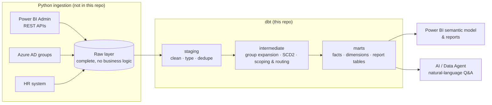

# Power BI Usage & Access Analytics — dbt project

An end-to-end analytics engineering project that answers a question every
large BI platform eventually asks:

> **Who has access to each Power BI semantic model and workspace — and are they actually using it?**

Raw Power BI activity and permission data (as landed by a Python ingestion job
from the Power BI Admin REST APIs), Azure AD group membership and HR data are
modeled with **dbt** into a tested, documented, **date-aware access × usage
audit** that feeds a Power BI semantic model and adoption/governance reports.

> All data in this repo is **synthetic** (generated by `scripts/generate_mock_data.py`,
> fictional `example.com` users). The design mirrors a production pipeline I built
> on Databricks, rebuilt here in dbt so it can be run by anyone.

---

## Architecture



**Medallion principle:** the raw layer stays *complete* (everything the service
principal can see). All business rules (scope exclusions, attribution) live in
dbt downstream — so scope can be re-cut later without re-fetching history.

### Lineage

| Layer | Models |
|---|---|
| **staging** (views) | `stg_pbi__workspaces`, `stg_pbi__workspace_apps`, `stg_pbi__semantic_models`, `stg_pbi__access_snapshots`, `stg_pbi__activity_events`, `stg_aad__group_member_snapshots`, `stg_hr__employee_extracts` |
| **intermediate** (views) | `int_hr__employee_history` (SCD2), `int_pbi__access_holders` (as-of group expansion), `int_pbi__activity_routed` (scope + routing) |
| **marts** (tables) | `fct_activity_events` (**incremental**), `fct_access_usage_daily` (**date-aware audit**), `rpt_access_usage_current`, `dim_workspaces`, `dim_semantic_models`, `dim_employees` (SCD2) |
| **exposure** | `bi_adoption_governance_report` (Power BI) |

Run `dbt docs generate && dbt docs serve` to browse the full lineage graph.

---

## What this project demonstrates

| Analytics engineering concept | Where |
|---|---|
| Layered modeling (staging → intermediate → marts) | `models/` |
| **Natural-key deduplication** (API event id proven not unique) | `stg_pbi__activity_events` |
| **Incremental model** with lookback window, idempotent re-runs | `fct_activity_events` |
| **SCD Type 2** from daily full extracts (gaps-and-islands) | `int_hr__employee_history` |
| **Point-in-time (as-of) joins** — permissions *and* group membership as they were on each day | `int_pbi__access_holders`, `fct_access_usage_daily` |
| Including **zero-usage rows** (access without activity) | `fct_access_usage_daily` |
| Solving **multi-group double counting** with a primary-row flag | `is_primary_access_row`, `usage_count_deduplicated` |
| Business rules in **one place** (vars + one scoping model) | `dbt_project.yml`, `int_pbi__activity_routed` |
| **Data contracts / fail-fast guards** | `tests/assert_workspace_apps_not_empty.sql` |
| **Reconciliation test** (audit usage = attributable events) | `tests/assert_usage_reconciles_to_events.sql` |
| **Grain tests** via a custom generic test | `tests/generic/unique_combination_of_columns.sql` |
| Warn-level **data-quality monitor** | `tests/warn_unattributed_event_share.sql` |
| Jinja macros & loops | `macros/`, `rpt_access_usage_current` |
| **CI/CD**: every PR rebuilds and tests everything | `.github/workflows/dbt_ci.yml` |
| Exposures (dashboard lineage) | `models/marts/_exposures.yml` |

---

## Key design decisions

1. **Dedup on the natural key** `(workspace_id, actor_upn, operation, event_time)`.
   The API's own `Id` was verified *not* unique and is blank in the historical
   CSV backfill; a pipeline run id identifies the run, not the event. When the
   same event exists in both sources, the API copy wins.
2. **Permission history = accumulated snapshots.** Each successful pipeline run
   appends a run-stamped permission snapshot. The audit pairs every activity
   day with the **latest snapshot on or before that day**, so failed runs fall
   back to the previous snapshot, and days before go-live fall back to the
   earliest one (`is_pre_capture_fallback`).
3. **Group expansion is also as-of**: group members come from the AAD snapshot
   valid when the permission snapshot was taken.
4. **Attribution routing** asks *"is this (workspace, dataset) one of OUR models
   in THIS workspace?"* — not *"does the event have a dataset id?"*. That
   correctly credits report-only workspaces whose reports use a model stored
   elsewhere, plus dataset-less operations (Copilot, external connections).
5. **Department as of the activity day** (SCD2), so transfers don't rewrite history.
6. **Multi-group access** keeps one row per granting group (useful for
   governance) but flags exactly one *primary* row, so
   `SUM(usage_count_deduplicated)` is always correct.
7. **Scope exclusions** (app workspaces owned by a separate App-layer pipeline;
   auto-created *Usage Metrics* datasets) are applied only downstream; the
   build fails if the app list is empty rather than silently double counting.

---

## Quickstart

```bash
git clone <this repo> && cd pbi-usage-access-analytics
python -m venv .venv && source .venv/bin/activate
pip install -r requirements.txt

python scripts/generate_mock_data.py      # synthetic raw data -> data/raw/
export DBT_PROFILES_DIR=.
dbt build                                 # 16 models + ~50 data tests
dbt docs generate && dbt docs serve       # lineage + documentation site
```

Runs locally on **DuckDB** — no cloud account needed.

### Running on Databricks

The SQL is written to be portable. Install `dbt-databricks`, copy
`profiles.databricks.example.yml` to `~/.dbt/profiles.yml`, and point the
`raw` source at the Delta tables written by the ingestion job.

---

## Example questions the marts answer

```sql
-- Adoption by department over time (transfers credited correctly)
select activity_date, department_as_of,
       count(distinct user_upn) filter (where is_active) as active_users,
       count(distinct user_upn)                          as users_with_access
from marts.fct_access_usage_daily
where scope_level = 'dataset'
group by all;

-- Governance: access that has never been used
select workspace_name, dataset_name, user_name, group_name
from marts.rpt_access_usage_current
where adoption_status = 'Never used' and is_primary_access_row;
```

---

## Project structure

```
├── models/
│   ├── staging/        # 1:1 with sources: rename, type, normalize, dedupe
│   ├── intermediate/   # business logic building blocks
│   └── marts/          # facts, dimensions, report tables, exposures
├── macros/             # normalize_blank, schema naming
├── tests/              # singular tests + custom generic test
├── scripts/            # synthetic data generator
└── .github/workflows/  # CI: build + test on every PR
```

## Roadmap

- dbt Semantic Layer (MetricFlow) metric definitions for adoption KPIs
- Source freshness checks on the raw tables
- Evaluation set for the AI Data Agent (question → expected answer accuracy)
